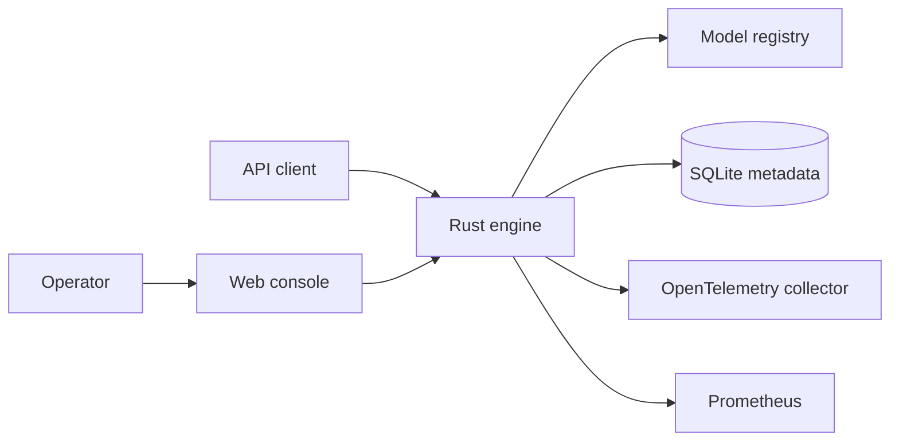
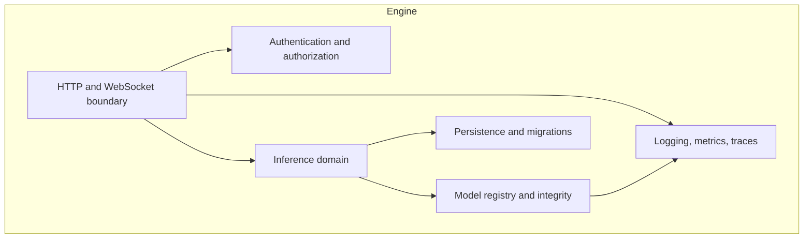

# Architecture

Copyright (c) 2026 Torviello.

Torviello Engine is a local-first inference service with a Rust core, a
TypeScript operator console, and a Python verification harness. The product
is split into independently releasable areas: `services`, `web`, `docs`,
`packaging`, and `media`.

## Scaffold status

The component and runtime views below are the **target architecture**. The
current Rust scaffold implements an HTTP shell with HS256 authentication,
configuration validation, RFC 9457 errors, health/readiness, metrics, and
version endpoints. It implements a validated model catalog, confined local
acquisition with digest verification, acquisition status and SSE progress, and
a model load lifecycle with single-flight initialization and reference-aware
unload. It does not yet implement remote Hugging Face acquisition, managed-asset
deletion, inference routes, SQLite persistence, OpenTelemetry export, WebSocket
transport, or the 22-path canonical contract (23 canonical operations, 32 with aliases). The React console is a shell. Treat
unimplemented boxes as planned, not as conformance evidence.

## System context

## Component view

The API layer owns transport concerns. The domain layer owns inference
policy and does not depend on API modules. Infrastructure adapters implement
ports declared by the domain. Shared contracts live under `contracts/` and
`schemas/` so handlers do not own interface types.

## Runtime boundaries

- Authentication is enabled by default and binds to loopback unless an
  operator opts into a remote profile.
- Request bodies, WebSocket frames, batches, decompression, and queues have
  explicit maximums and timeouts.
- Bulkheads, circuit breakers, and retries isolate model, storage, and
  upstream failures.
- Health exposes separate liveness and readiness signals.
- Model downloads require HTTPS and a SHA-256 checksum before activation.

## Quality attributes

Availability, latency, isolation, auditability, and recoverability are
evaluated against the thresholds in [SLO.md](SLO.md). Architecture decisions
are recorded under [adr/](adr/); module ownership is in
[OWNERSHIP.md](OWNERSHIP.md).
