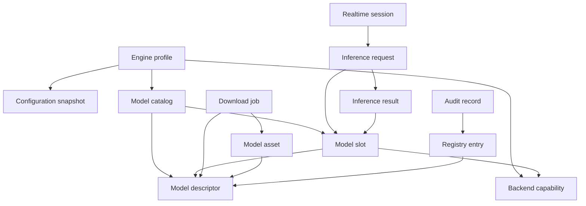

# Engine entities and value objects

This document names the domain objects that specifications, contracts, and tests use. It complements the [glossary](glossary.md) and the [business rules](business-rules.md). An entity has identity and lifecycle; a value object is defined only by its values.

## Aggregates

### Engine profile

The root aggregate for one running configuration. It owns the resolved configuration snapshot, the selected backend capabilities, the model catalog, the serving listeners, and the readiness state.

| Attribute | Meaning |
|---|---|
| Profile ID | Stable name such as `local-cpu` or `local-cuda`. |
| Configuration snapshot | Immutable resolved configuration with sources. |
| Backend selection | Active provider, device, precision, and reason. |
| Model catalog | Descriptors plus runtime slots. |
| Lifecycle state | Starting, ready, degraded, draining, or stopped. |

The profile does not own request payloads or session buffers.

### Model descriptor

The durable description of a model. It is immutable for a given model ID and version.

| Attribute | Meaning |
|---|---|
| Model ID | Stable identifier unique within a profile. |
| Version | Model revision or asset revision. |
| Task | TTS, STT, classification, detection, chat, or generic tensor. |
| Format | ONNX, PyTorch, safetensors, GGUF, or another declared format. |
| Backend requirements | Providers, precision, and runtime constraints. |
| Input contract | Shape, dtype, maximum dimensions, sample rate, or text limit. |
| Assets | Content-addressed files with sizes and digests. |
| Provenance | Source, license reference, and acquisition record. |

Catalog state (downloaded, verified, loaded) is not part of the descriptor. It belongs to the asset and runtime projections.

### Model slot

The runtime instance of one descriptor. It owns the loaded session, reference count, and lifecycle state.

| State | Meaning |
|---|---|
| `unloaded` | No runtime resources are held. |
| `queued` | A load has been admitted but initialization has not started. |
| `loading` | Initialization is in progress. |
| `ready` | Inference may acquire a reference. |
| `draining` | Unload or eviction is waiting for references to reach zero. |
| `failed` | Initialization or execution failed and the slot is unusable until reloaded. |

A slot is addressed by the same model ID as its descriptor. Two slots MUST NOT exist for one ID at the same time.

### Backend capability

A provider the running build can actually execute on this host.

| Attribute | Meaning |
|---|---|
| Backend ID | CPU, CUDA, Metal, Vulkan, ROCm, or another declared provider. |
| Availability | Available, compiled but unusable, or unavailable, with a reason. |
| Device | Device index and memory if known. |
| Precision | Supported and selected precision. |
| Limits | Maximum concurrency, memory, and supported operators. |

A compiled feature flag alone is not a capability.

### Inference request

One caller's unit of work. It carries identity and policy, not transport types.

| Attribute | Meaning |
|---|---|
| Request ID | Correlation identifier from ingress or generated at the edge. |
| Capability | TTS, STT, classification, detection, chat, or generic tensor. |
| Model ID | Requested model or engine. |
| Inputs | Validated, sanitized capability-specific input. |
| Parameters | Thresholds, top-k, voice, language, or execution options. |
| Limits | Deadline, batch policy, and cache policy. |
| Caller binding | Metadata that must be returned only to this caller. |

The request MUST NOT contain provider handles, file paths outside the model root, or transport-specific request objects.

### Inference result

The output of one execution, including attribution.

| Attribute | Meaning |
|---|---|
| Output | Capability-specific value. |
| Model ID | Model actually executed. |
| Backend | Provider, device, and precision actually used. |
| Timing | Server-side execution latency and optional stage timings. |
| Postprocessing | Applied flag, ordered steps, and warnings. |
| Status | Success or a typed failure. |

A result without attribution cannot be cached or evaluated and is invalid.

### Download job

A bounded acquisition of one model asset set.

| Attribute | Meaning |
|---|---|
| Task ID | Stable job identifier. |
| Model ID | Destination model identity. |
| Source | Repository, URL, or local import with declared scheme. |
| State | Queued, downloading, verifying, extracting, ready, failed, or cancelled. |
| Progress | Bytes transferred and total when known. |
| Integrity | Expected digest or signature and verification outcome. |
| Terminal reason | Stable code and safe message. |

### Realtime session

A negotiated WebSocket interaction.

| Attribute | Meaning |
|---|---|
| Session ID | Server-assigned identity for logs and limits. |
| Transport | Audio, classification, or detection. |
| Negotiation state | Awaiting ready, configured, streaming, or closing. |
| Buffers | Bounded input and output buffers. |
| Active work | Cancellation token and current capability invocation. |
| Peer policy | Authentication and rate-limit identity inherited from ingress. |

### Registry entry and audit record

A registry entry is a descriptor admitted through the administrative surface. An audit record is an append-only statement that a mutation was attempted and what happened.

Audit fields are actor, action, target model ID, outcome, timestamp, and request ID. Audit records are not editable through the public API.

## Value objects

| Value object | Rules |
|---|---|
| Model ID | Stable, non-empty, unique within a profile, never derived from a path or display name. |
| Asset digest | Algorithm plus lowercase hex digest; verified before activation. |
| Backend ID | Closed vocabulary declared by the build profile. |
| Precision | Closed vocabulary: fp32, fp16, bf16, int8, or declared quantized variants. |
| Request ID | Bounded length and safe character set; generated if absent or unsafe. |
| Error code | Stable machine-readable identifier independent of prose. |
| Deadline | Absolute or relative duration with a stated origin. |
| Limit | Value, unit, and scope: request, item, session, model, or process. |
| Source descriptor | Scheme plus required locator fields; no implicit local file access. |

## Relationships

## Ownership

The engine technical owner owns the profile, catalog, slots, capabilities, and request/result types. The serving edge owns transport mapping and request IDs. The model registry owns administrative admission and audit. Changes to a shared identity rule require all three owners.

## Assurance

Governed by [HPA-4](../../torviello-enforcer/requirements/assurance-standard.md) and the [engine acceptance criteria](../specifications/acceptance-criteria.md).
- **Subject:** Entities and value objects.
- **Required evidence:** Identity, immutability, equality, and lifecycle rules MUST be stated and tested; provider or transport types MUST NOT appear in the domain model.
- **Failure:** An ambiguous identity, a mutable value object, or a leaked provider type fails acceptance. No waiver is permitted.
