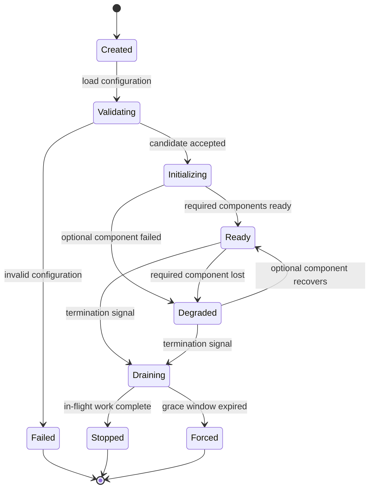
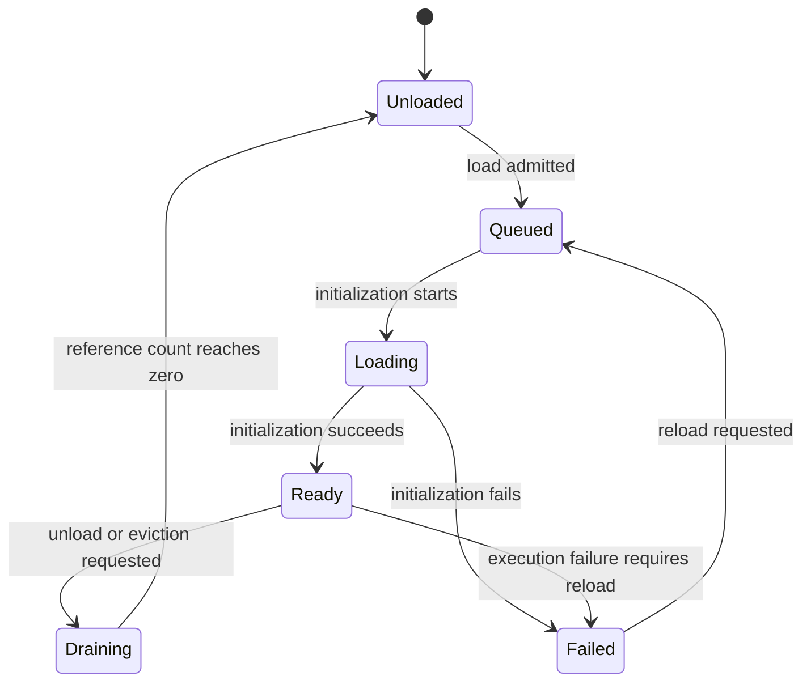
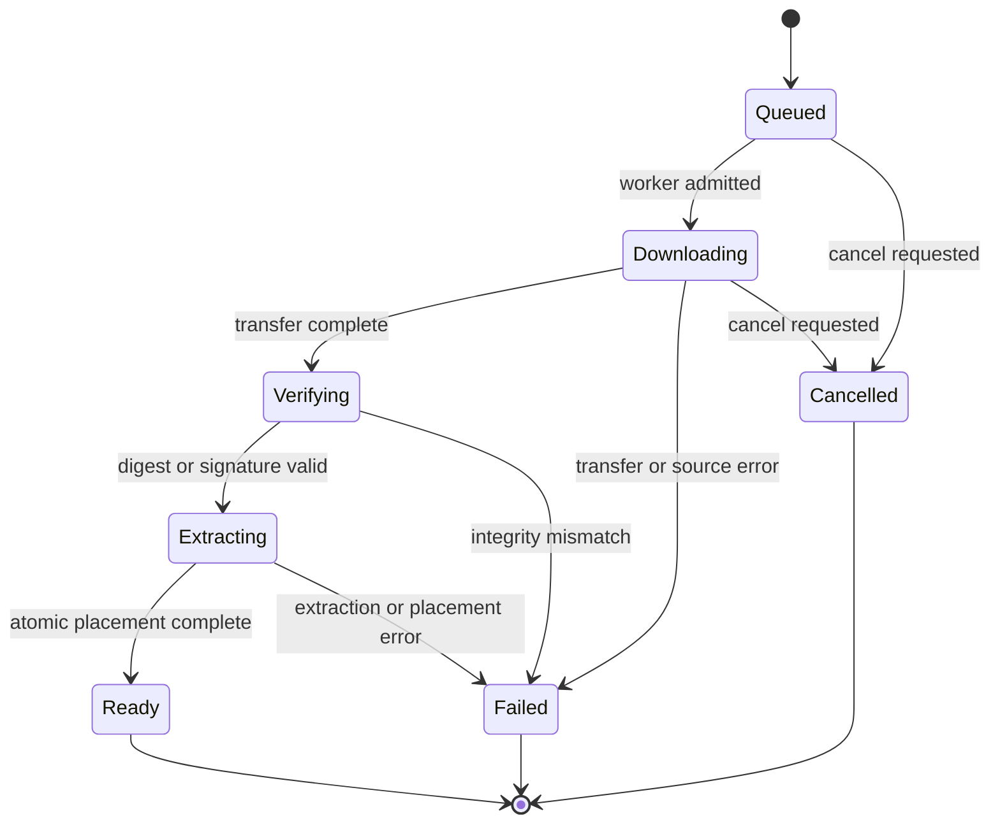

# Engine lifecycles

The engine has several nested lifecycles. Confusing them produces the most common operational failures: treating a bound socket as readiness, treating a registry entry as a loaded model, or treating a queued download as an available asset.

## Engine lifecycle

| Transition | Guard | Observable effect |
|---|---|---|
| Created → Validating | Process starts | Configuration candidate is read. |
| Validating → Initializing | Complete candidate valid | Listener may bind; readiness remains false. |
| Initializing → Ready | Required models and providers ready | Readiness returns 200. |
| Initializing → Degraded | Optional component failed | Process alive; health names the failed component. |
| Ready → Draining | Termination signal | Admission stops immediately. |
| Draining → Stopped | All work completed | Exit status 0 and shutdown record. |
| Draining → Forced | Grace window expired | Work cancelled, forced exit recorded. |
| Validating → Failed | Validation error | Non-zero exit before listener bind. |

Readiness is a projection of required stages, not a separate lifecycle. Liveness is true from Initializing through Draining while the runtime can accept control work; it does not require a model.

## Configuration lifecycle

1. Read built-in defaults.
2. Read the selected TOML file if present.
3. Apply namespaced environment overrides.
4. Apply command-line overrides.
5. Validate the complete candidate, including cross-field constraints and secret strength.
6. Publish one immutable snapshot to all components.

If a reload capability is added later, it repeats steps 1–5 into a new candidate and swaps the snapshot only after validation and dependency checks. A failed reload retains the previous snapshot and reports the failure. Partial activation is prohibited.

## Model lifecycle

Rules:

- A load request for an ID already Loading or Ready joins the existing operation; it does not start a second initialization.
- Inference acquires a reference only in Ready. A request that arrives during Loading either waits within its deadline or returns a retryable unavailable error according to policy.
- Unload marks Draining, stops new references, waits for existing references, then frees resources.
- A capacity eviction uses the same Draining path and must select a model with zero references.
- A Failed slot is not usable for inference and does not become Ready without a new load.

## Download job lifecycle

A job is terminal in Ready, Failed, or Cancelled. Only Ready assets are listed as available. Progress events are emitted on state changes and at a bounded interval during Downloading. The event stream closes after the terminal state.

## Inference lifecycle

1. Admit the request under body, item, concurrency, and rate limits.
2. Assign or validate the request ID.
3. Authenticate and authorize when enabled.
4. Validate and sanitize inputs.
5. Resolve the model and acquire a reference.
6. Check the cache; return a hit only when the key and entry are valid.
7. Coalesce with an identical in-flight request or admit to a batch.
8. Execute on a blocking-capable worker under a deadline and circuit policy.
9. Postprocess the result.
10. Build the envelope with attribution, warnings, and request ID.
11. Store a valid cache entry when caching is enabled.
12. Release the model reference and concurrency permit.
13. Emit request metrics and one structured log record.

A failure at any step releases every resource acquired by earlier steps. Steps 1–4 must reject before step 8 allocates model input.

## Streaming lifecycle

A stream has three phases: negotiation, transfer, and termination.

| Phase | Required behavior |
|---|---|
| Negotiation | Validate capability, model, parameters, and framing; send metadata before data. |
| Transfer | Emit ordered frames or events, apply backpressure on a bounded channel, enforce per-chunk deadlines. |
| Termination | Emit a terminal frame when possible, close the stream, release the producer and worker slot. |

Client disconnect moves the stream directly to termination. A producer MUST observe cancellation and stop. A terminal error frame is best-effort after disconnect; resource release is not.

## Realtime session lifecycle

1. Upgrade and authenticate under the same edge policy as HTTP.
2. Send a ready frame or an error frame and close.
3. Accept a config or control frame that establishes capability and parameters.
4. Stream bounded binary frames and dispatch work.
5. Emit ordered result frames or a stable error frame.
6. On close, cancel active work, release buffers, and decrement session metrics.

A session cannot move from negotiation to streaming without a successful config for transports that require one.

## Shutdown lifecycle

1. Receive a termination signal.
2. Stop admitting new requests and new sessions.
3. Cancel download jobs that are not complete, recording their terminal state.
4. Drain in-flight inference within the configured grace window.
5. Cancel remaining work and close streams.
6. Stop workers and release model resources in dependency order.
7. Emit the shutdown record and exit with a status that distinguishes clean from forced termination.

A component that hangs must not prevent health, logging, or the forced-exit path from running.

## Assurance

Governed by [HPA-4](../../torviello-enforcer/requirements/assurance-standard.md) and the [engine acceptance criteria](../specifications/acceptance-criteria.md).
- **Subject:** Lifecycle and state transitions.
- **Required evidence:** States, guards, transitions, terminal states, and recovery paths MUST be modeled and exhaustively checked, including invalid-transition rejection.
- **Failure:** An unmodeled transition, an unreachable state, or a state that violates an invariant fails acceptance. No waiver is permitted.
